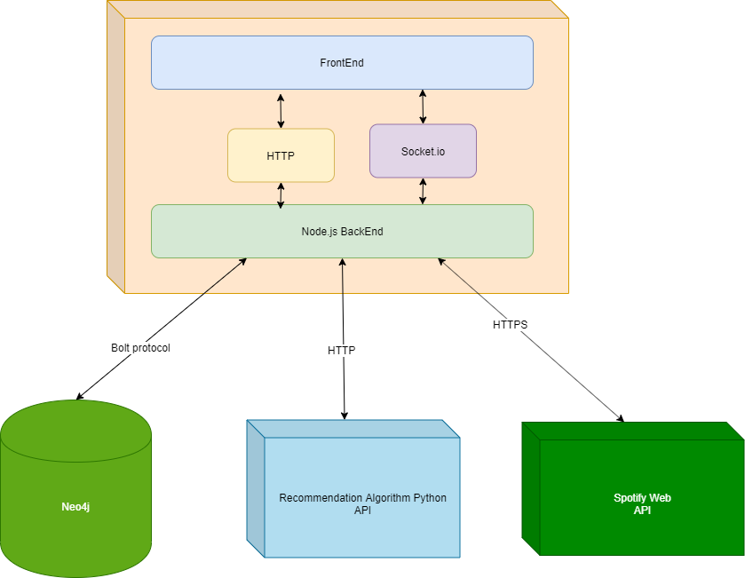
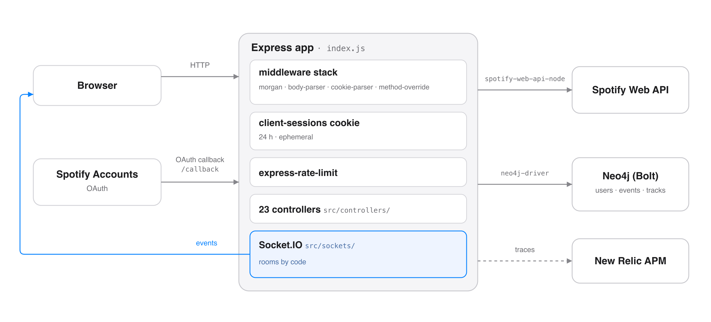

# Plyst Me — backend API for a music recommendation platform

The server that ran Plyst Me: Spotify login, user taste mining, playlist generation, and
collaborative listening events over sockets. Started 2019, where I was CTO. Product code, not
an exercise — it shipped, and the recommendation model was part of my responsibility.

This README is written from the code, not from memory. Every claim below was checked against a
file on 2026-11-10.

## Architecture



*The product as deployed: the browser talks HTTP and Socket.IO to this backend. The backend reaches
Neo4j over Bolt, a separate Python recommendation service over HTTP, and the Spotify Web API over
HTTPS. The Python service is not in this repository; that is what the old `requirements.txt`
reference was pointing at.*



*Inside this repository: everything enters through Express and passes the middleware stack and the
signed session cookie. The Socket.IO server is **not** a second process — it is mounted on the same
app, which is why the event arrow leaves the container and comes back to the browser.*

### One request, in order

1. `morgan`, `body-parser`, `cookie-parser` and `method-override` run on every request.
2. The signed `sessions` cookie is loaded and validated.
3. `express-rate-limit` applies to the recommendation endpoints.
4. A controller in `src/controllers/` handles the route and fans out to Neo4j or Spotify.
5. New Relic records the trace around the whole thing.

## What the server does

| Area | What it handles |
|---|---|
| **Auth** | Spotify OAuth: `/login` → `/callback`, with a signed session cookie |
| **Users** | Profile, preferences, per-user track history, user mining (`/mineria`) |
| **Recommendation** | `/pool` and `/callback` feed a queue, `/guardar/top50` persists a ranking |
| **Playlists** | `/create/playlist`, `/save/track`, `/track/profile` |
| **Events** | Collaborative listening rooms over Socket.IO, with join codes |
| **Ops** | `/heartbeat`, `/idle`, `/chequeoBD`, `/esHost`, `/esInvitado` |

## Stack, read from `package.json`

| | |
|---|---|
| Runtime | Node.js (`engines`: **v20.2.0**), CommonJS |
| HTTP | **Express** with `body-parser`, `cookie-parser`, `method-override`, `morgan`, `express-rate-limit` |
| Realtime | **Socket.IO** |
| Database | **Neo4j** over Bolt (`neo4j-driver`), hosted on GraphENEDB |
| Music API | **spotify-web-api-node** |
| Sessions | **client-sessions** — a signed cookie, not a server-side store |
| APM | **New Relic** (`newrelic.js`) |
| Audio | `supercolliderjs` is a dependency, but the SC controller is commented out |

## Running it

```bash
npm install
npm start        # node index.js
npm run dev      # nodemon index.js, for development only
```

`npm start` runs the server directly. It used to launch `nodemon`, which put a file
watcher in front of a production process and was also the source of two dev-only
advisories; the watcher now lives in `npm run dev`.

Two branches at startup, and they behave differently:

- **`PORT == 5001`** — local mode. Callback goes to `http://localhost:5001/callback`.
- **anything else** — server mode. Callback goes to `https://www.plystme.com/callback`.

### Environment variables the code reads

| Variable | Used by |
|---|---|
| `PORT` | Express listen port; also selects local vs server mode |
| `client_id`, `client_secret` | Spotify OAuth |
| `GRAPHENEDB_BOLT_URL`, `GRAPHENEDB_BOLT_USER`, `GRAPHENEDB_BOLT_PASSWORD` | Neo4j connection |

There is no `requirements.txt` and no Python in this repository. The recommendation service
in the product diagram above ran separately, over HTTP.

## HTTP surface

`index.js` mounts one controller per feature under `src/controllers/`:

| Route | Controller |
|---|---|
| `/`, `/heartbeat`, `/idle` | `inicio`, `heartbeat`, `idle` |
| `/login`, `/logOut` | `login`, `logOut` |
| `/callback`, `/pool` | `callbackAlgoritmo`, `poolAlgoritmo` |
| `/perfil`, `/preferencias`, `/usuarios`, `/userid` | `perfil`, `preferencias`, `usuarios` |
| `/track/profile`, `/save/track` | `perfilTrack`, `saveTrack` |
| `/create/playlist`, `/guardar/top50` | `guardaPlaylist`, `guardarTOP50` |
| `/mineria`, `/rango`, `/DatosBD`, `/chequeoBD` | `mineriaUsuario`, `rangoTiempo`, `DatosBD`, `chequeoBD` |
| `/esHost`, `/esInvitado`, `/environment` | `esHost`, `environmentSC` |
| `/error`, `*` | error handler and catch-all in `index.js` |

## Socket surface

`src/sockets/mainSocket.js` wires the events in `src/sockets/Eventos/`:

`connection` · `crearEvento` · `crearEventoCodigo` · `EventoConexion` · `usuarioNuevoCodigo` ·
`usuarioNuevoUbicacion` · `disconnect`

## Dependencies

`npm audit`: **two moderate advisories, both dev-only** (`nodemon` and its transitive
`minimatch`). Everything reachable from the server is clean.

Dependencies are current: `ejs` 3.1.10, `newrelic` 14.12.0, `nodemon` 3.1.14. The file watcher
lives in `devDependencies`, so it never reaches a production install, and the unused
`supercolliderjs` dependency is gone.

## Scope

This is a 2019 codebase, kept as the record of what shipped rather than as something to run
today. The recommendation model itself ran as a separate Python service over HTTP and is not
part of this repository. The Node side here is the API, the sockets and the graph queries.

## Security

- **Credentials never live in the repository.** The Spotify client secret and the Neo4j
  connection come from environment variables (`client_secret`, `GRAPHENEDB_BOLT_*`). The
  Spotify client id appears in the code because client ids are public identifiers; the secret
  is what signs the requests.
- **Sessions are a signed cookie**, not a server-side store: named `sessions`, valid for 24
  hours, with an active duration of 5 minutes, and `ephemeral`.
- **The recommendation endpoints are rate limited** before they reach a controller.
- **User-supplied HTML is sanitised** with `sanitize-html` before it is stored or rendered.

## License

MIT — see `LICENSE`.
